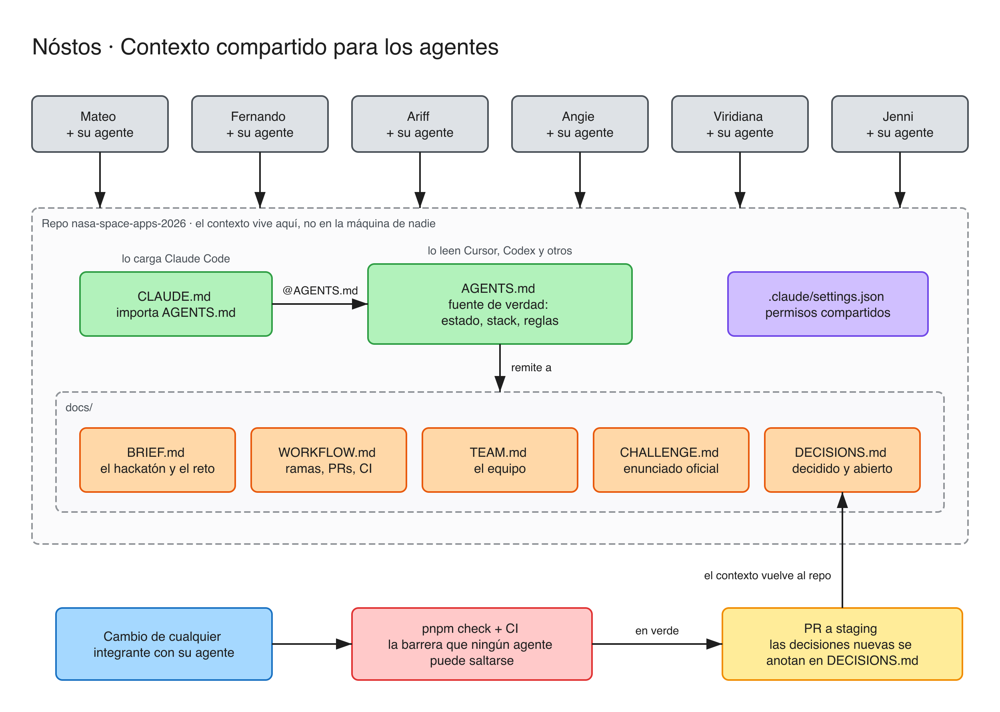

# Space Apps 2026 — Health Monitor

Proyecto del equipo **Nóstos** para el [NASA Space Apps Challenge 2026](https://www.spaceappschallenge.org/2026/), reto [Create Health Monitoring Software for Astronauts on Space Missions](https://www.spaceappschallenge.org/2026/challenges/health-monitoring-software/).

El nombre es provisional y el producto aún no está definido. Por ahora el repo es la plantilla sobre la que vamos a construir.

## Empezar

Necesitas Node 24 y pnpm.

```bash
git clone <url-del-repo>
cd <carpeta-del-repo>
pnpm install
pnpm dev
```

Antes de abrir un PR:

```bash
pnpm check
```

## Documentación

| Archivo                                | Contenido                                           |
| -------------------------------------- | --------------------------------------------------- |
| [docs/BRIEF.md](docs/BRIEF.md)         | El hackatón y el reto, resumidos.                   |
| [docs/DECISIONS.md](docs/DECISIONS.md) | Qué está decidido y qué sigue abierto.              |
| [docs/WORKFLOW.md](docs/WORKFLOW.md)   | Ramas, PRs, CI y despliegue.                        |
| [docs/TEAM.md](docs/TEAM.md)           | El equipo.                                          |
| [docs/CHALLENGE.md](docs/CHALLENGE.md) | Enunciado oficial del reto, en inglés.              |
| [AGENTS.md](AGENTS.md)                 | Contexto y reglas para los agentes de cada persona. |

## Diagramas

Están en [docs/diagrams/](docs/diagrams/), como imagen (`.png`, `.svg`) y como archivo editable (`.excalidraw`, se abre en https://excalidraw.com).

- [Flujo de ramas](docs/diagrams/flujo-git.png)
- [CI/CD](docs/diagrams/ci-cd.png)
- [Contexto compartido para los agentes](docs/diagrams/contexto-agentes.png)

## Trabajar con un agente



Abre el repo con tu agente (Claude Code, Cursor, Codex u otro). El agente lee `AGENTS.md` y con eso sabe de qué trata el hackatón, qué está decidido y cómo se trabaja aquí. Si tomas una decisión con tu agente, pídele que la deje anotada en `docs/DECISIONS.md` para que el resto del equipo la reciba.
