<p align="center">
  
</p>

<h1 align="center">Nóstos</h1>

<p align="center">
  A crew health companion for long space missions.<br>
  Each astronaut checks in by voice, measures with a fingertip sensor and gets clear guidance on what to do next.
</p>

<p align="center">
  
  
  
  
  
</p>

<p align="center">
  <a href="https://space-apps-2026.jfernandocasher22.workers.dev"><strong>Live demo</strong></a>
  ·
  <a href="https://www.spaceappschallenge.org/2026/challenges/health-monitoring-software/">The challenge</a>
  ·
  <a href="#screens">Screens</a>
  ·
  <a href="#run-it-locally">Run it locally</a>
</p>

---

Built by team **Nóstos** for the [NASA Space Apps Challenge 2026](https://www.spaceappschallenge.org/2026/), challenge **Create Health Monitoring Software for Astronauts on Space Missions**.

> **Prototype.** Nóstos is a hackathon project, not a medical device. It never presents a diagnosis.

## What it is

On a trip to Mars, a message to Earth takes up to 24 minutes each way. The crew has to notice problems and act on their own.

In Nóstos every astronaut has **Lunito**, an axolotl whose belly is a traffic light for how they are doing today: **Good**, **Caution** or **Alert**. The astronaut tells Lunito how they woke up, places a finger on a sensor for a minute, and Lunito answers with their status, the reason, and one thing to do.

Three ideas hold the product together:

- **Rules decide, the AI only speaks.** Status, alerts and escalation come from plain rules with a cited source. The language model turns speech into fields and words the answer; it never makes a health decision.
- **Everything is ordered by NASA's five hazards of human spaceflight** (radiation, isolation, distance, gravity, environment).
- **The crew acts first.** An emergency opens a case on board, sends a structured report to Earth, and keeps working during the delay.

## Screens

Captured on a tablet in landscape (1024 x 768), the device the app is designed for. It also works on a phone and on a laptop.

<table>
  <tr>
    <td width="50%">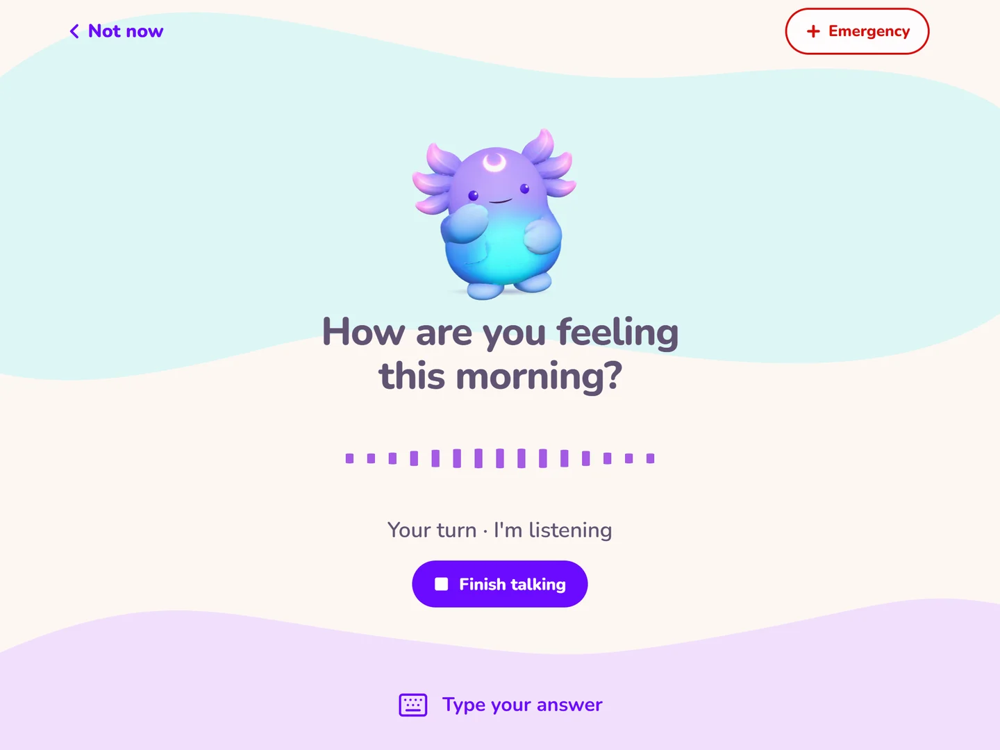<br><sub><b>Morning check-in.</b> Lunito asks out loud, listens hands-free and stops when you go quiet.</sub></td>
    <td width="50%">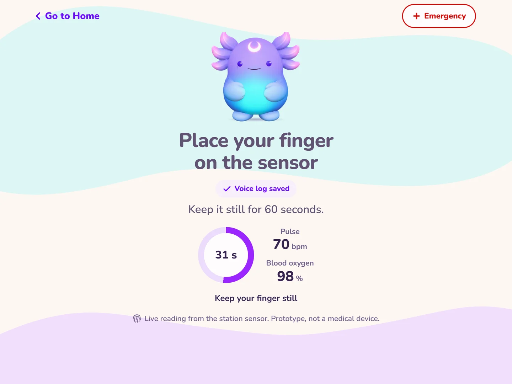<br><sub><b>Sensor reading.</b> Pulse and blood oxygen live over Bluetooth for 60 seconds.</sub></td>
  </tr>
  <tr>
    <td>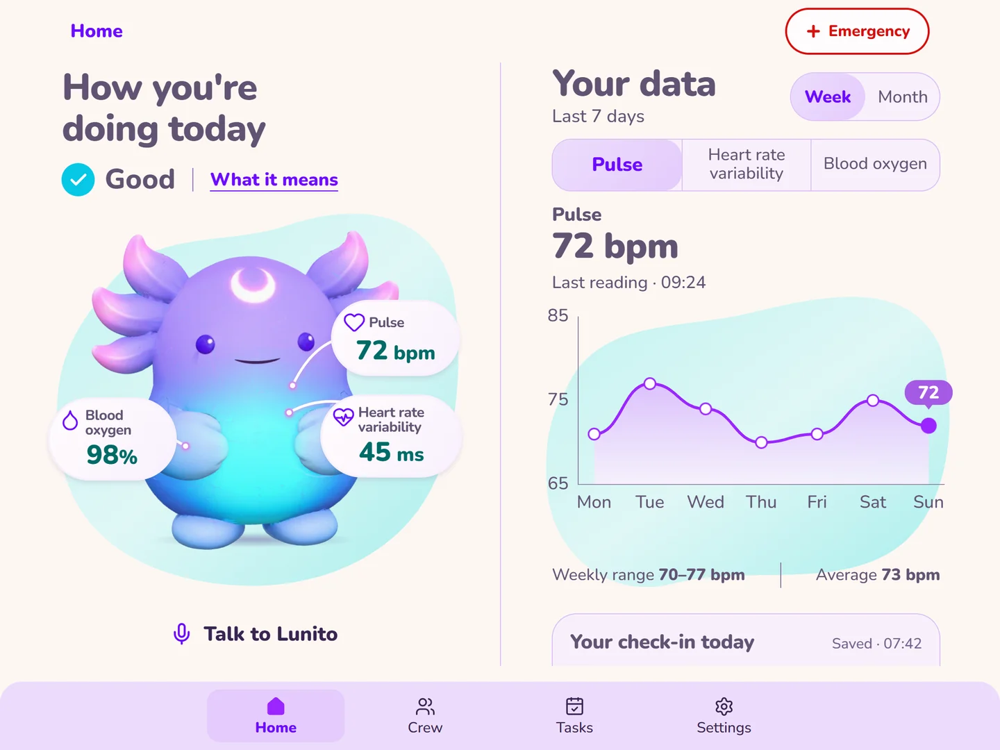<br><sub><b>Home.</b> Today's status on Lunito's belly, the three indicators and the week's trend.</sub></td>
    <td>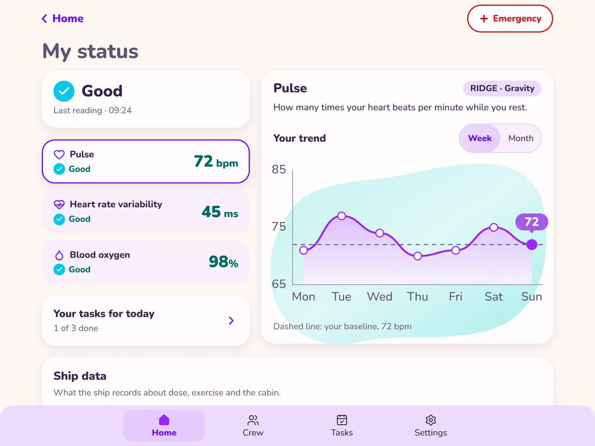<br><sub><b>My status.</b> Each indicator against the personal baseline, plus what the ship records.</sub></td>
  </tr>
  <tr>
    <td>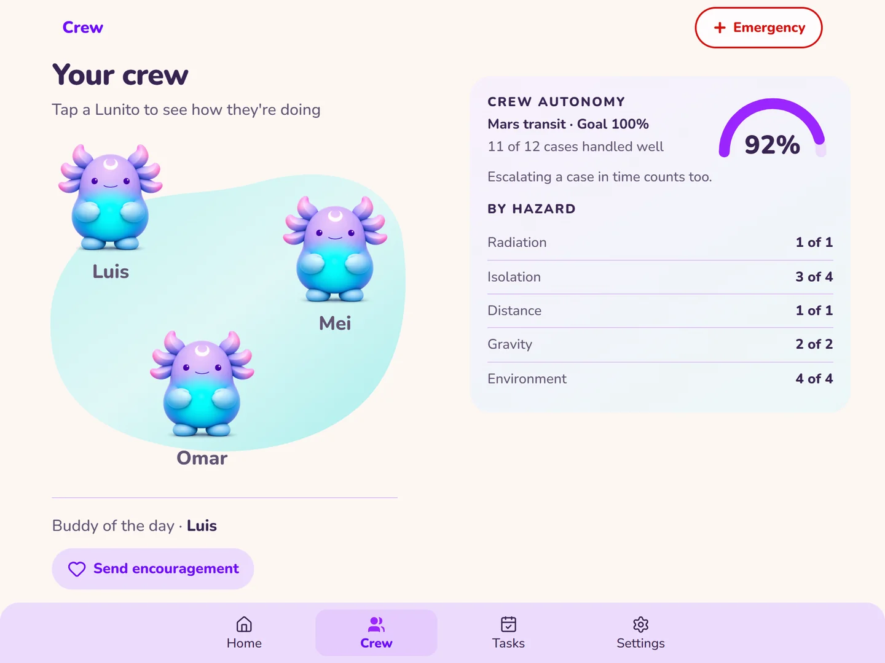<br><sub><b>Crew.</b> Shared status only, a buddy for the day and the crew's autonomy by hazard.</sub></td>
    <td>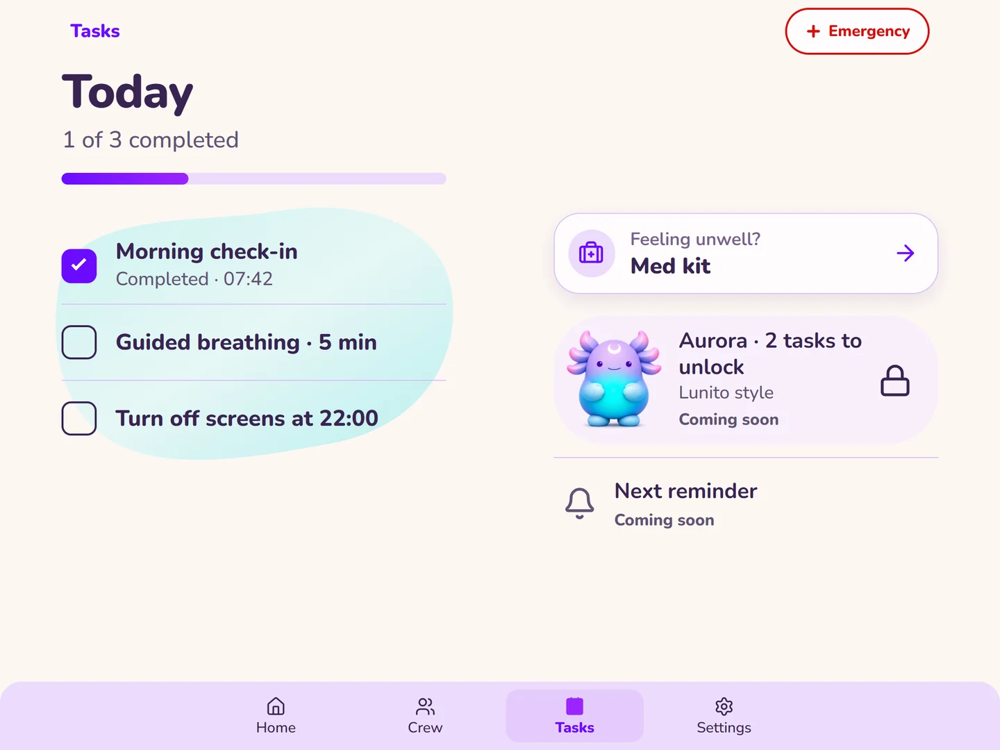<br><sub><b>Tasks.</b> The check-in and today's actions; the med kit is one tap away.</sub></td>
  </tr>
  <tr>
    <td>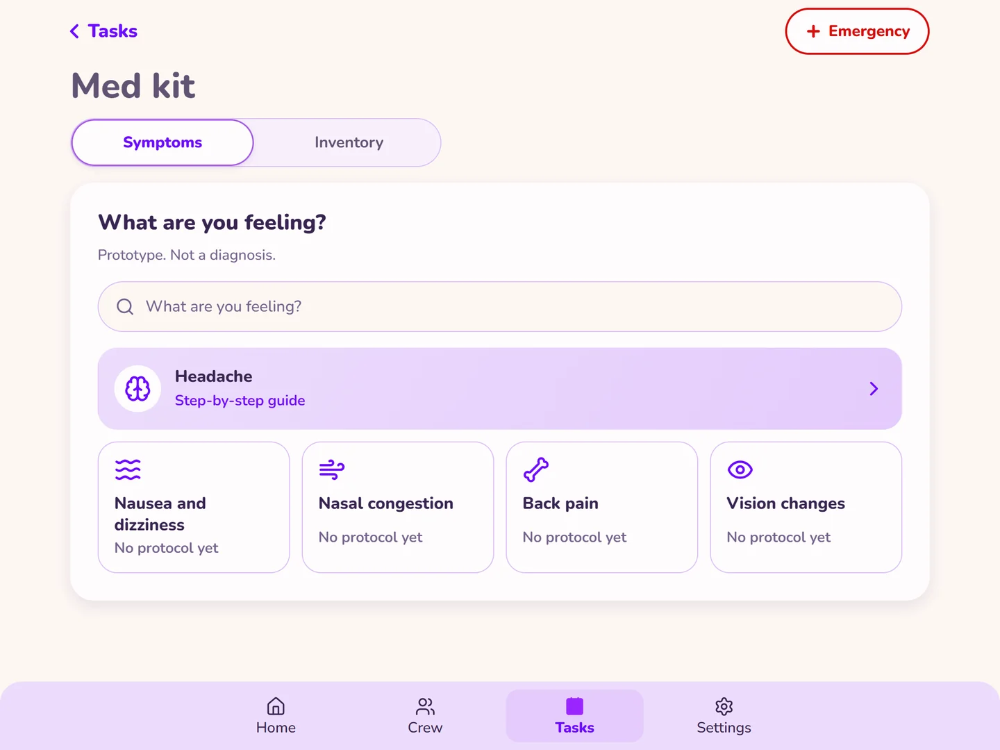<br><sub><b>Med kit.</b> A step-by-step headache guide with red flags and the ISS inventory.</sub></td>
    <td>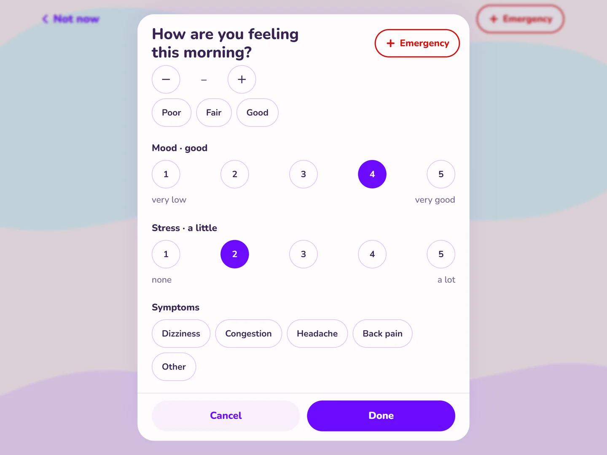<br><sub><b>"This is what I understood."</b> Every field can be corrected by hand before saving.</sub></td>
  </tr>
  <tr>
    <td>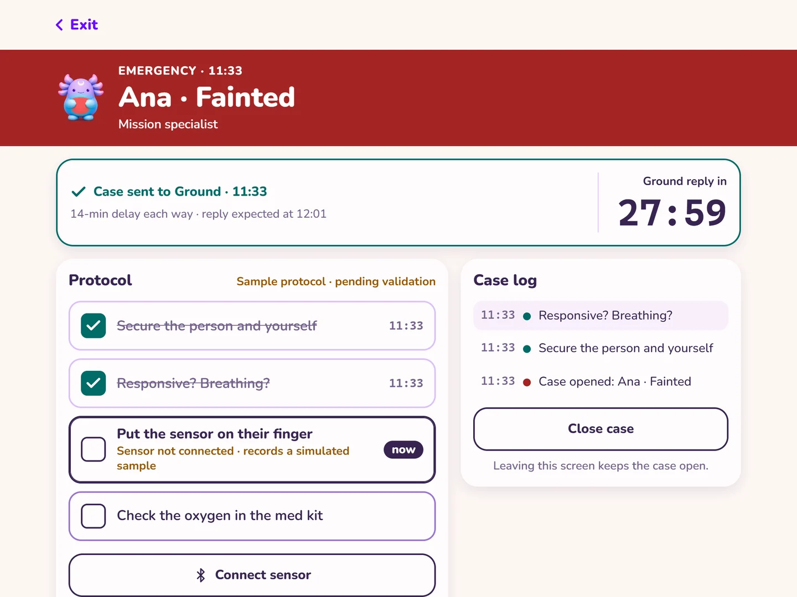<br><sub><b>Emergency on board.</b> Protocol checklist, case log and the countdown to Earth's reply.</sub></td>
    <td>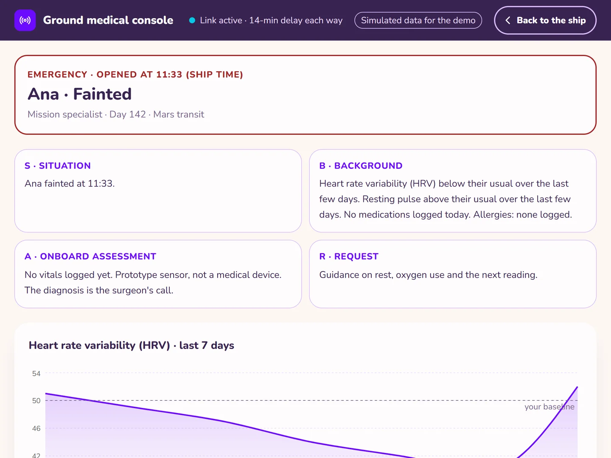<br><sub><b>Ground console.</b> The flight surgeon receives the case as an SBAR report and answers.</sub></td>
  </tr>
</table>

## What it does

|                                                                       | Feature             | What happens                                                                                                                                                     |
| :-------------------------------------------------------------------: | ------------------- | ---------------------------------------------------------------------------------------------------------------------------------------------------------------- |
|                | Voice check-in      | A voice-to-voice conversation. Lunito asks only what is missing (sleep, mood, stress, symptoms), reads back what it understood and saves it.                     |
|          | Real sensor         | An ESP32-C3 with a MAX30102 sends pulse and blood oxygen over Bluetooth LE. The app validates the 60-second reading and rejects it if the finger moved.          |
|        | Daily traffic light | Each indicator is compared with the astronaut's own baseline. The result is a status, the reason, and the hazard it belongs to.                                  |
|           | Trends              | Seven-day and four-week charts for pulse, heart rate variability and blood oxygen.                                                                               |
|              | Crew                | Each person chooses whether to share their status. An Alert is never published to the crew; it goes to the medical officer through a case.                       |
|     | Tasks               | The morning check-in and today's actions, such as guided breathing (a sample list in the demo).                                                                  |
|  | Med kit             | A headache protocol with red flags, cabin CO2 and doses from NASA's published ISS medical kit list.                                                              |
|              | Emergency           | One tap from every screen. Opens a case, logs each step with its time and sends it to Earth. An Alert status proposes sending the report; it is never automatic. |
|     | Ground console      | The Earth side: the case as an SBAR report, the trend and a reply box. The link has a simulated 14-minute delay each way.                                        |
|          | Two languages       | English (official) and Spanish, including voice, speech recognition and Lunito's mouth.                                                                          |
|             | Safety rules        | An emergency phrase never reaches the language model, and any reply naming a drug, a dose or a diagnosis is discarded.                                           |

## How it works

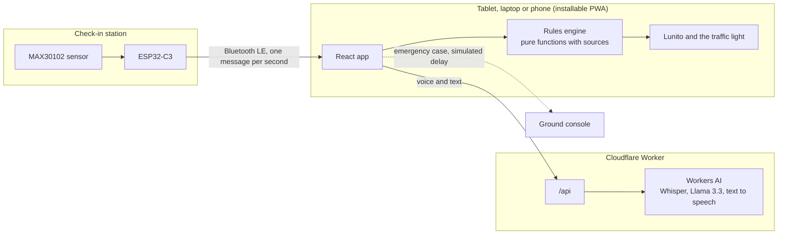

1. **Listen.** The microphone records in the browser; the Worker transcribes with Whisper and a language model turns the text into fields (sleep, mood, stress, symptoms).
2. **Measure.** The station streams pulse and blood oxygen; the app keeps the median of the valid seconds.
3. **Decide.** Pure functions compare each value with the personal baseline and with thresholds that have a cited source. They produce the status, the reason and the action.
4. **Speak.** The model only puts into words what the rules already decided, and Lunito says it.
5. **Escalate.** If something is wrong, the crew opens a case; Earth sees it after the delay and answers.

Without the Worker the app still works: it falls back to the browser's speech recognition and voice, and to fixed sentences.

## What it measures

Sixteen variables: nine about the person, six about the ship and one about the mission. "Recorded" means the value is saved and shown, and travels with an emergency report, but does not change the status today.

| Variable                           | Source                         | Moves the traffic light |
| ---------------------------------- | ------------------------------ | :---------------------: |
| Pulse                              | Sensor (real)                  |           Yes           |
| Blood oxygen (SpO2)                | Sensor (real)                  |           Yes           |
| Heart rate variability (HRV)       | Simulated (see the note below) |           Yes           |
| Sleep hours                        | Voice check-in                 |        Recorded         |
| Sleep quality                      | Voice check-in                 |        Recorded         |
| Mood                               | Voice check-in                 |        Recorded         |
| Stress                             | Voice check-in                 |        Recorded         |
| Symptoms                           | Voice check-in                 |        Recorded         |
| Reaction time                      | Optional test in the check-in  |        Recorded         |
| Cabin CO2                          | Ship feed (simulated)          |           Yes           |
| Cumulative radiation dose          | Ship feed (simulated)          |           Yes           |
| Weekly exercise                    | Ship feed (simulated)          |           Yes           |
| Cabin temperature                  | Ship feed (simulated)          |          Shown          |
| Cabin pressure                     | Ship feed (simulated)          |          Shown          |
| Cabin humidity                     | Ship feed (simulated)          |          Shown          |
| Link with Earth (delay, open case) | Mission state                  |           Yes           |

## What is real and what is simulated

| Real                                                                      | Simulated for the demo                                         |
| ------------------------------------------------------------------------- | -------------------------------------------------------------- |
| Voice transcription, field extraction and Lunito's replies (Workers AI)   | Personal baseline (the rule needs days measured before flight) |
| Pulse and blood oxygen from the station over Bluetooth                    | History of the week and the month                              |
| The rules engine and every threshold it uses                              | Ship data (CO2, radiation, exercise, cabin) and sleep history  |
| The emergency flow, the case log and the SBAR report                      | The link with Earth and its delay; other crew members          |
| English and Spanish, the installable app and offline loading of the shell | Data shared between devices (everything stays in this browser) |

Two limits worth knowing:

- **HRV is not measured by the current firmware**, because it does not send the time between heartbeats. When a reading comes from the sensor, HRV shows as "not measured" instead of being filled in.
- **The sensor is not clinical grade** and its SpO2 is not calibrated.

## The station

| Part          | Detail                                                                          |
| ------------- | ------------------------------------------------------------------------------- |
| Board         | ESP32-C3 mini                                                                   |
| Sensor        | MAX30102 (pulse oximeter), I2C                                                  |
| Link          | Bluetooth LE, read from the browser with Web Bluetooth                          |
| Message       | Text `pulse,spo2` once per second; `0` means no valid value                     |
| Where it runs | Chrome or Edge on desktop and Android, over HTTPS or on `localhost`. Not on iOS |

The app side lives in [`src/features/sensor/`](src/features/sensor/). Without a station, the check-in offers a simulated reading and says so.

## NASA resources we used

Every health threshold in the product cites its source; the full list is in [docs/FUENTES.md](docs/FUENTES.md). We used NASA standards, technical briefs and Human Research Program pages. We did not use NASA datasets.

| NASA resource                                                             | Where it is used                                           |
| ------------------------------------------------------------------------- | ---------------------------------------------------------- |
| HRP, 5 Hazards of Human Spaceflight                                       | The whole app is organized by the five hazards             |
| HRP, Risks of Human Spaceflight                                           | Context for what to watch                                  |
| OCHMO-TB-004, Carbon Dioxide (NASA-STD-3001 Vol. 2)                       | Cabin CO2 alerts and the headache protocol                 |
| OCHMO technical brief, Radiation Protection                               | Cumulative dose limit                                      |
| OCHMO-TB-031, Exercise Overview                                           | Weekly exercise target                                     |
| OCHMO-TB-033, Spaceflight Experience and Medical Care                     | Space adaptation in the headache protocol                  |
| ISS Medical Kit checklist (2015)                                          | Doses shown in the med kit                                 |
| Spaceflight Standard Measures (NTRS)                                      | Personal baseline measured before flight                   |
| Exploration Medical Integrated Operations, ConOps 2024 (NTRS)             | Crew autonomy and the emergency flow                       |
| NASA Goddard and ASCEND communications papers                             | Earth to Mars delay of 4 to 24 minutes                     |
| NASA-STD-3001 Vol. 2 section 10 and the Human Integration Design Handbook | Controls usable while floating: large targets, no keyboard |

Other sources: NEWS2 and the British Thoracic Society for pulse and SpO2 limits, Plews et al. for the baseline rule, and two Canadian Space Agency pages.

## Tech stack

| Layer    | Choice                                                                                |
| -------- | ------------------------------------------------------------------------------------- |
| App      | React 19, TypeScript (strict), Vite, Tailwind CSS 4, installable PWA                  |
| Lunito   | three.js with React Three Fiber; eight poses, four gestures and lip sync, all in code |
| Backend  | One Cloudflare Worker serves the app and the `/api` routes                            |
| AI       | Workers AI: Whisper large v3 turbo, Llama 3.3 70B and MeloTTS, with no API keys       |
| Sensor   | Web Bluetooth, with hand-written types and no extra dependency                        |
| Quality  | Prettier, Oxlint, Vitest (about 800 unit tests) and Playwright (end to end)           |
| Delivery | GitHub Actions runs the checks and deploys staging and production                     |

## Run it locally

You need Node 24 and pnpm.

```bash
git clone https://github.com/Fernando-Castro-Hernandez/nasa-space-apps-2026.git
cd nasa-space-apps-2026
pnpm install
pnpm dev
```

`pnpm dev` starts the app alone. Without the API, Lunito uses the browser's speech recognition and voice, and fixed sentences. To run it with the real API and AI, in another terminal:

```bash
pnpm dlx wrangler@4 login   # once, with a Cloudflare account
pnpm build
pnpm dev:api
```

| Command        | What it does                                                 |
| -------------- | ------------------------------------------------------------ |
| `pnpm dev`     | Development server.                                          |
| `pnpm dev:api` | Local Worker with the API; `pnpm dev` forwards `/api` to it. |
| `pnpm check`   | Format, lint, types, tests and build. The same as CI.        |
| `pnpm test`    | Unit tests with Vitest.                                      |
| `pnpm e2e`     | End-to-end tests with Playwright on the build.               |

To try it in two minutes: open the app, do the check-in (speak, or tap **Type your answer**), then open **Settings > Demo panel** to raise the cabin CO2, change the reading shown on Home or simulate an emergency.

## Project structure

```text
src/
  api/          Contract and client for the Worker, and the rules around the AI
  app/          Router, routes and navigation
  domain/       Health rules as pure functions, each with its source
  data/         Sample crew, history and ship feed
  features/
    day-checkin/  The morning check-in conversation
    voice/        Microphone, transcription and the voice log
    sensor/       Bluetooth station: protocol, validity rule and stores
    lunito/       The 3D Lunito, its poses, voice and chat
    lunito-home/  Home, Crew, Tasks and Settings
    status/       My status
    medicine/     Med kit and protocols
    emergency/    Emergency on board and the Ground console
  i18n/         English and Spanish texts
worker/         Cloudflare Worker: static app and /api (Workers AI)
e2e/            Playwright tests
docs/           Product, design and process documents
```

## Team

| Member          | Background                                                            |
| --------------- | --------------------------------------------------------------------- |
| Mateo           | Software development student; builds digital products.                |
| Fernando Castro | Software development student; junior developer.                       |
| Ariff           | Software development student.                                         |
| Angie           | Nutrition student, interested in technology and AI applied to health. |
| Viridiana       | Embedded systems engineer; built the sensor station.                  |
| Jenni           | Computational robotics engineer; works across software and hardware.  |

## Documentation

The project documents are written in Spanish, the team's working language.

| File                                   | Contents                                                 |
| -------------------------------------- | -------------------------------------------------------- |
| [docs/BRIEF.md](docs/BRIEF.md)         | The hackathon and the challenge, summarized.             |
| [docs/SISTEMA.md](docs/SISTEMA.md)     | The system: Lunito, the traffic light, emergencies.      |
| [docs/DISENO.md](docs/DISENO.md)       | Visual design and the screen references.                 |
| [docs/FUENTES.md](docs/FUENTES.md)     | Health rules and their sources.                          |
| [docs/DECISIONS.md](docs/DECISIONS.md) | What is decided and what is still open.                  |
| [docs/PRD.md](docs/PRD.md)             | Requirements and scope of the MVP.                       |
| [docs/HISTORIAS.md](docs/HISTORIAS.md) | User stories and acceptance criteria.                    |
| [docs/WORKFLOW.md](docs/WORKFLOW.md)   | Branches, pull requests, CI and deployment.              |
| [docs/CHALLENGE.md](docs/CHALLENGE.md) | The official challenge statement.                        |
| [AGENTS.md](AGENTS.md)                 | Shared context and rules for each member's coding agent. |

Process diagrams (branch flow, CI/CD and shared agent context) are in [docs/diagrams/](docs/diagrams/).
