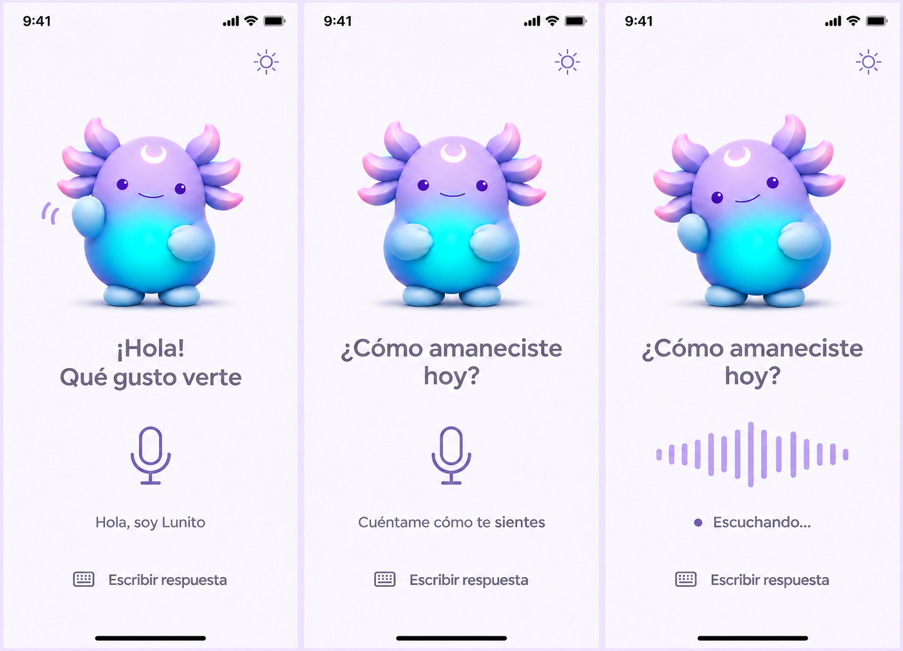
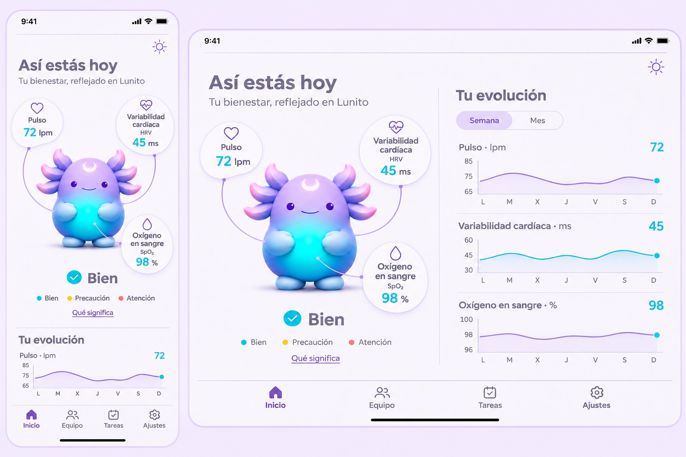
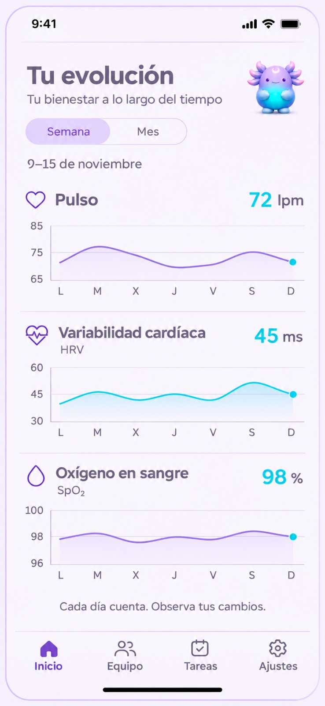

# Propuesta visual

Dirección visual de la app. El concepto de Lunito y sus reglas están en [SISTEMA.md](SISTEMA.md) (sección 1); las pantallas, en la sección 9.

## Maqueta integral aprobada · Órbita

La referencia integral del rediseño está en [diseno/prototipos/orbita.html](diseno/prototipos/orbita.html). Se abre directamente en un navegador y reúne Inicio, Equipo, Tareas, Ajustes, Check-in, Emergencia y Tierra en los tamaños de escritorio, tablet y celular.

- La maqueta fija la estructura, jerarquía, lenguaje visual, movimiento y adaptación responsive.
- Las imágenes de abajo siguen fijando el contenido y el flujo de Inicio; cuando haya una diferencia puramente visual, manda la maqueta Órbita.
- Es una referencia de diseño, no sustituye la aplicación React ni duplica sus datos o reglas de salud.
- Cada responsable porta su pantalla según [REPARTO.md](REPARTO.md). Ariff conserva en exclusiva la estructura global, navegación y tokens de `src/App.tsx`, `src/index.css` y `src/app/`.
- El selector de paleta, voz y estado de la esquina es una herramienta de comparación de la maqueta y no forma parte del producto final.

## Referencias finales (modelo exacto del frontend)

Estas imágenes son **la referencia exacta** de cómo se ve la app. Si algo de este documento o del código actual las contradice, mandan las imágenes. Los puntos donde chocaban con reglas anteriores ya están decididos abajo. Las demás pantallas todavía no tienen referencia final; se diseñarán después siguiendo este mismo estilo.

### Flujo del día

1. **Al abrir la app al inicio del día**, lo primero es el check-in conversacional con Lunito (referencia 1). No se entra directo al dashboard.
2. **Al terminar ese ejercicio**, la app pasa a "Así estás hoy" (referencia 2).
3. "Tu evolución" (referencia 3) muestra las tendencias; en tablet va junto a "Así estás hoy" y en celular, debajo o en su propia vista.

### 1 · Check-in del día

Tres estados, una sola idea por pantalla:

- **Saludo:** Lunito saluda con la mano. Título "¡Hola! Qué gusto verte". Micrófono y "Hola, soy Lunito".
- **Pregunta:** "¿Cómo amaneciste hoy?". Micrófono y "Cuéntame cómo te sientes".
- **Escuchando:** misma pregunta; el micrófono se convierte en una onda de voz animada y aparece "● Escuchando…".
- En los tres estados está la opción **"Escribir respuesta"** con ícono de teclado, para responder sin voz.
- Lunito grande y centrado, título grande, mucho aire, sin tarjetas ni barra de navegación.

### 2 · Así estás hoy

- Título "Así estás hoy" y subtítulo "Tu bienestar, reflejado en Lunito".
- Lunito al centro. Tres **burbujas redondas** salen de él con una línea curva fina. Cada burbuja lleva ícono, nombre, unidad técnica en pequeño y el valor grande en cian:
  - **Pulso** (corazón): 72 lpm.
  - **Variabilidad cardíaca · HRV** (corazón con pulso): 45 ms.
  - **Oxígeno en sangre · SpO₂** (gota): 98 %.
- Debajo, el estado en una palabra con ícono: "✓ Bien". Leyenda de tres estados: **Bien** (cian), **Precaución** (amarillo) y **Atención** (rojo). Enlace "Qué significa" para explicar el semáforo.
- En tablet: Lunito a la izquierda y "Tu evolución" a la derecha, separados por una línea vertical fina.

### 3 · Tu evolución

- Título "Tu evolución" y subtítulo "Tu bienestar a lo largo del tiempo". Lunito pequeño arriba a la derecha.
- Selector **Semana / Mes** y el rango de fechas ("9–15 de noviembre").
- Una gráfica de área suave por indicador (pulso, HRV, SpO₂) con días L–D, eje con tres valores y el último valor grande en cian, con un punto cian al final de la línea.
- Cierre: "Cada día cuenta. Observa tus cambios."

### Estilo común

- Fondo lila muy claro, sin bordes duros; tarjetas y burbujas blancas con sombra suave.
- Títulos grandes y redondeados en gris violeta; valores en **cian**; líneas de gráficas en lila y cian.
- Barra inferior con cuatro pestañas: **Inicio, Equipo, Tareas y Ajustes**, con la activa en lila.
- Ícono de sol arriba a la derecha.

### Decidido sobre las referencias

Donde las referencias chocaban con reglas anteriores, **mandan las referencias** (decisión del 2026-11-15). La única excepción es el botón Emergencia, que es una regla de seguridad:

- **Botón Emergencia:** sigue siempre visible en todas las pantallas, incluido el check-in del día (`SISTEMA.md` §7.5). Va arriba a la derecha, junto al ícono de sol, rojo y con la palabra "Emergencia".
- **Navegación:** barra inferior con **Inicio, Equipo, Tareas y Ajustes**; desaparece la barra lateral.
  - **Inicio:** al empezar el día, el check-in conversacional; después, "Así estás hoy" y "Tu evolución". Reemplaza a Mi Lunito, Mi estado y Check-in.
  - **Equipo:** la Constelación de la tripulación.
  - **Tareas:** las acciones del día y el Botiquín (síntomas, asistente de dolor de cabeza e inventario).
  - **Ajustes:** selección de perfil y "Compartir mi estado".
  - La consola de Tierra (`/tierra`) y el panel de la demo (`/demo`) quedan fuera de la barra: se abren por su dirección.
- **Color de "Bien":** cian, el color natural de la pancita. El verde deja de usarse para estados.
- **Nombres de estado:** **Bien**, **Precaución** y **Atención**. Donde otros documentos dicen verde, ámbar o amarillo, y rojo, se refieren a estos tres estados.
- **Valores en las burbujas y gráficas:** van en el color del estado de su indicador (cian cuando está Bien), para que el color siga siendo solo de estado.
- **Línea base:** las gráficas de "Tu evolución" no llevan la línea punteada. La línea base sigue decidiendo el semáforo y se muestra al cirujano en la consola de Tierra.
- **De qué parte del cuerpo sale cada dato:** el pulso sale del brazo izquierdo, la HRV de la mano derecha y el oxígeno de la pancita, como en la referencia 2.
- **Lunito saludando:** se anima con los brazos que prepara Viridiana según [LUNITO-ARTE.md](LUNITO-ARTE.md). Mientras tanto, Lunito saluda sin mover los brazos.
- **Ícono de sol:** cambia entre tema claro y oscuro. El claro es el principal; el oscuro es secundario y puede llegar después.

## Idea

Profesional pero limpio, en **tema claro** y pensado para tablet. **Lunito es la única ilustración**: todo lo demás es tipografía, tarjetas y color de estado. La app tiene barra inferior (Inicio, Equipo, Tareas y Ajustes) y el botón Emergencia siempre arriba.

## Lunito

El semáforo vive en su pancita:

| Bien (cian)                | Precaución (amarillo)                    | Atención (rojo)                        |
| -------------------------- | ---------------------------------------- | -------------------------------------- |
| Pancita en su cian natural |  |  |
| "Bien"                     | "Precaución · motivo"                    | "Atención · motivo"                    |

- `lunito-hoja.jpg`: hoja original (frente, perfil, espalda y tres cuartos).
- `lunito-ambar.png`, `lunito-rojo.png`: frente sin fondo, listas para usar en la app. `lunito-verde.png` queda de la versión anterior; para Bien se usa la pancita cian.
- El color nunca va solo: siempre lo acompaña una palabra (regla 3 de Lunito).
- Pendiente: cómo distinguir al Lunito de cada tripulante (color de aletas o un accesorio).

## Lunito en 3D

- Modelo: `public/lunito.glb`, generado con Meshy y separado en partes con nombre (`body`, `belly`, `gill_L/R_1..3`, `eye_L`, `eye_R`) para animar cada una.
- Nada se pinta encima del modelo: la pancita queda en su cian natural cuando está Bien y **gira su tono** a amarillo o rojo y conserva su textura; las branquias se aclaran u oscurecen según el oxígeno.
- Movimiento con sentido: la pancita late al ritmo del pulso, el cuerpo respira según la HRV. En reposo flota, se balancea y parpadea. Con `prefers-reduced-motion` se queda quieto.
- Las imágenes 2D de `diseno/` se usan donde no conviene un canvas 3D (constelación, emergencia).
- Lunito habla con voz: la boca sigue lo que dice, y tiene expresiones (nunca tristes ni enojadas) y gestos. Partes nuevas, formas de boca y cómo prepararlas en Blender: [LUNITO-ARTE.md](LUNITO-ARTE.md).

## Colores

Los tokens viven en `src/index.css` (variables de shadcn/ui en OKLCH).

| Uso               | Token                           |
| ----------------- | ------------------------------- |
| Fondo             | `--background` (lila muy claro) |
| Tarjetas          | `--card` (blanco)               |
| Texto             | `--foreground`                  |
| Texto secundario  | `--muted-foreground`            |
| Primario          | `--primary` (lila de Lunito)    |
| Estado Bien       | `--status-ok` (cian)            |
| Estado Precaución | `--status-warn` (amarillo)      |
| Estado Atención   | `--status-alert` (rojo)         |

Cian, amarillo y rojo se usan **solo** para estados, nunca como decoración, y siempre con una palabra.

## Tipografía

- **Inter** para todo; jerarquía por tamaño y peso.
- Mínimo 15 px para texto de lectura y botones de al menos 44 px de alto: se usa flotando y con prisa.

## Patrones

- Tarjetas de shadcn (`Card`) con borde suave y esquinas redondeadas.
- Botón principal: `--primary` con texto claro, al menos 44 px de alto.
- Botón **Emergencia** rojo arriba a la derecha en todas las pantallas.
- Gráficas de área suaves de 7 días o del mes, sin línea base punteada.
- En emergencia desaparece todo lo lúdico: banner rojo, alto contraste y nada de animaciones decorativas.
