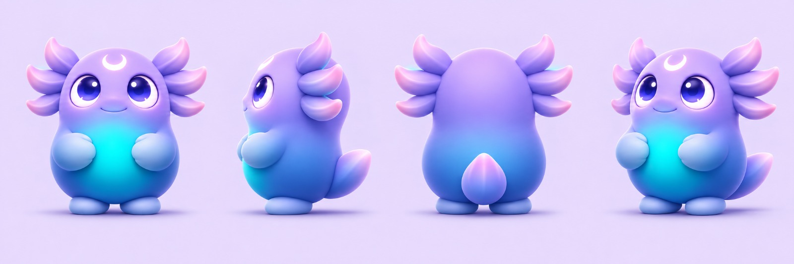
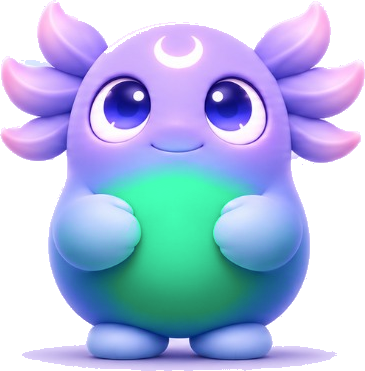
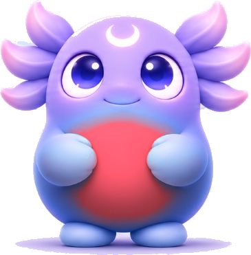

# Propuesta visual

Dirección visual de la app. El concepto de Lunito y sus reglas están en [SISTEMA.md](SISTEMA.md) (sección 1); las pantallas, en la sección 9.

## Idea

Profesional pero limpio, en **tema claro** y pensado para tablet. **Lunito es la única ilustración**: todo lo demás es tipografía, tarjetas y color de estado. La app es un shell con barra lateral (shadcn/ui) y el nombre de la pantalla siempre arriba.

## Lunito

El semáforo vive en su pancita:

| Verde                                    | Ámbar                                    | Rojo                                   |
| ---------------------------------------- | ---------------------------------------- | -------------------------------------- |
|  |  |  |
| "Todo en orden"                          | "Revisar · motivo"                       | "Atención · motivo"                    |

- `lunito-hoja.jpg`: hoja original (frente, perfil, espalda y tres cuartos).
- `lunito-verde.png`, `lunito-ambar.png`, `lunito-rojo.png`: frente sin fondo, listas para usar en la app.
- El color nunca va solo: siempre lo acompaña una palabra (regla 3 de Lunito).
- Pendiente: cómo distinguir al Lunito de cada tripulante (color de aletas o un accesorio).

## Lunito en 3D

- Modelo: `public/lunito.glb`, generado con Meshy y separado en partes con nombre (`body`, `belly`, `gill_L/R_1..3`, `eye_L`, `eye_R`) para animar cada una.
- Nada se pinta encima del modelo: la pancita **gira su tono** (cian → verde, ámbar o rojo) y conserva su textura; las branquias se aclaran u oscurecen según el oxígeno.
- Movimiento con sentido: la pancita late al ritmo del pulso, el cuerpo respira según la HRV. En reposo flota, se balancea y parpadea. Con `prefers-reduced-motion` se queda quieto.
- Las imágenes 2D de `diseno/` se usan donde no conviene un canvas 3D (constelación, emergencia).
- Lunito habla con voz: la boca sigue lo que dice, y tiene expresiones (nunca tristes ni enojadas) y gestos. Partes nuevas, formas de boca y cómo prepararlas en Blender: [LUNITO-ARTE.md](LUNITO-ARTE.md).

## Colores

Los tokens viven en `src/index.css` (variables de shadcn/ui en OKLCH).

| Uso              | Token                           |
| ---------------- | ------------------------------- |
| Fondo            | `--background` (lila muy claro) |
| Tarjetas         | `--card` (blanco)               |
| Texto            | `--foreground`                  |
| Texto secundario | `--muted-foreground`            |
| Primario         | `--primary` (lila de Lunito)    |
| Estado verde     | `--status-ok`                   |
| Estado ámbar     | `--status-warn`                 |
| Estado rojo      | `--status-alert`                |

Verde, ámbar y rojo se usan **solo** para estados, nunca como decoración, y siempre con una palabra.

## Tipografía

- **Inter** para todo; jerarquía por tamaño y peso.
- Mínimo 15 px para texto de lectura y botones de al menos 44 px de alto: se usa flotando y con prisa.

## Patrones

- Tarjetas de shadcn (`Card`) con borde suave y esquinas redondeadas.
- Botón principal: `--primary` con texto claro, al menos 44 px de alto.
- Botón **Emergencia** rojo en el header de todas las pantallas.
- Gráficas de 7 días con la línea base punteada.
- En emergencia desaparece todo lo lúdico: banner rojo, alto contraste y nada de animaciones decorativas.
