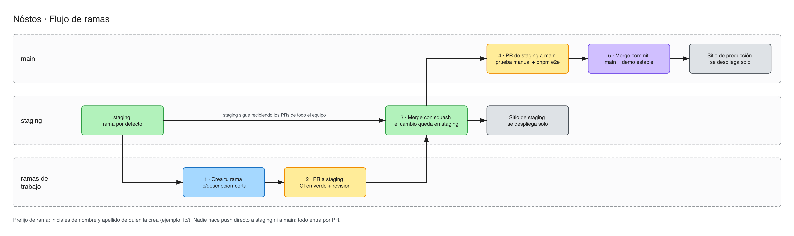
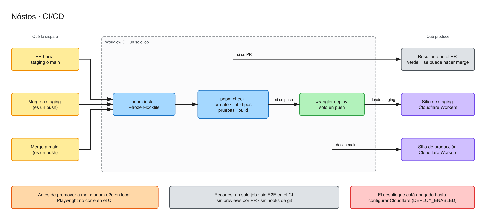

# Flujo de trabajo



## Ramas

| Rama              | Para qué sirve                                                          | Cómo recibe cambios                 |
| ----------------- | ----------------------------------------------------------------------- | ----------------------------------- |
| `main`            | Lo que se entrega y se muestra en el demo. Siempre debe funcionar.      | Solo por PR desde `staging`.        |
| `staging`         | Integración: aquí se juntan y se prueban los cambios de todo el equipo. | Solo por PR desde ramas de trabajo. |
| `<iniciales>/...` | El trabajo de una persona sobre un cambio concreto.                     | Commits directos de quien la creó.  |

`staging` es la rama por defecto del repo: al clonar quedas en ella y los PRs nuevos apuntan a ella.

### Nombres de rama

Cada rama de trabajo empieza con las iniciales de quien la crea, en minúsculas y sin acentos, seguidas de una descripción corta con guiones:

```
<iniciales>/<descripcion-corta>
fc/pantalla-inicio
```

Se usan las iniciales de nombre y apellido, no solo la del nombre: Ariff y Angie compartirían la `a`.

## Paso a paso

1. Actualiza `staging` y crea tu rama:

   ```bash
   git switch staging
   git pull
   git switch -c fc/nombre-corto
   ```

2. Trabaja y haz commits pequeños. Antes de subir, corre `pnpm check`.

3. Sube la rama y abre el PR hacia `staging`:

   ```bash
   git push -u origin fc/nombre-corto
   gh pr create --base staging
   ```

4. Cuando el CI esté en verde y alguien más lo haya revisado, se hace merge con **squash**. Eso despliega el sitio de staging.

5. Para publicar, se abre un PR de `staging` a `main`. Antes de aprobarlo:
   - Se prueba a mano el sitio de staging.
   - Se corre `pnpm e2e` en local sobre `staging`.

   Este PR se cierra con **merge commit**, no con squash. Con squash las dos ramas dejan de compartir historia y el siguiente PR muestra conflictos falsos.

### ¿Push o merge?

Son el mismo evento. Al hacer merge de un PR, GitHub hace un push a la rama destino, y el workflow se dispara con ese push. Nadie hace push directo a `main` ni a `staging`: todo entra por PR.

## CI/CD



Hay un solo workflow, [.github/workflows/ci.yml](../.github/workflows/ci.yml), con un solo job:

| Cuándo corre                | Qué hace                                             |
| --------------------------- | ---------------------------------------------------- |
| PR hacia `staging` o `main` | `pnpm check`: formato, lint, tipos, pruebas y build. |
| Push a `staging`            | `pnpm check` y despliegue del sitio de staging.      |
| Push a `main`               | `pnpm check` y despliegue del sitio de producción.   |

La pantalla principal muestra el entorno y el commit desplegado, para saber qué versión se está viendo en cada sitio.

### Recortes para ir rápido

- **Un solo job.** Verificar y desplegar van juntos, sin artefactos ni etapas.
- **Sin E2E en el CI.** Playwright corre en local antes de publicar a `main`. Instalar navegadores en cada corrida es lo más lento de un pipeline.
- **Sin previews por PR.** Solo existen dos sitios: staging y producción.
- **Sin hooks de git.** La barrera es el CI; en local basta con `pnpm check`.

Si después sobra tiempo, lo primero que conviene agregar es el E2E en los PRs hacia `main`.

## Activar el despliegue

El paso de despliegue está apagado hasta que se configure Cloudflare. Mientras tanto el CI solo verifica. Para activarlo, una sola vez:

1. Crear una cuenta en Cloudflare, si no existe.
2. Crear un token de API con la plantilla "Edit Cloudflare Workers" y copiar el Account ID.
3. Guardar ambos en el repo y encender el despliegue:

   ```bash
   gh secret set CLOUDFLARE_API_TOKEN
   gh secret set CLOUDFLARE_ACCOUNT_ID
   gh variable set DEPLOY_ENABLED --body true
   ```

Los sitios quedan en `space-apps-2026.<subdominio>.workers.dev` (producción) y `space-apps-2026-staging.<subdominio>.workers.dev` (staging). Los nombres se cambian en [wrangler.jsonc](../wrangler.jsonc).
